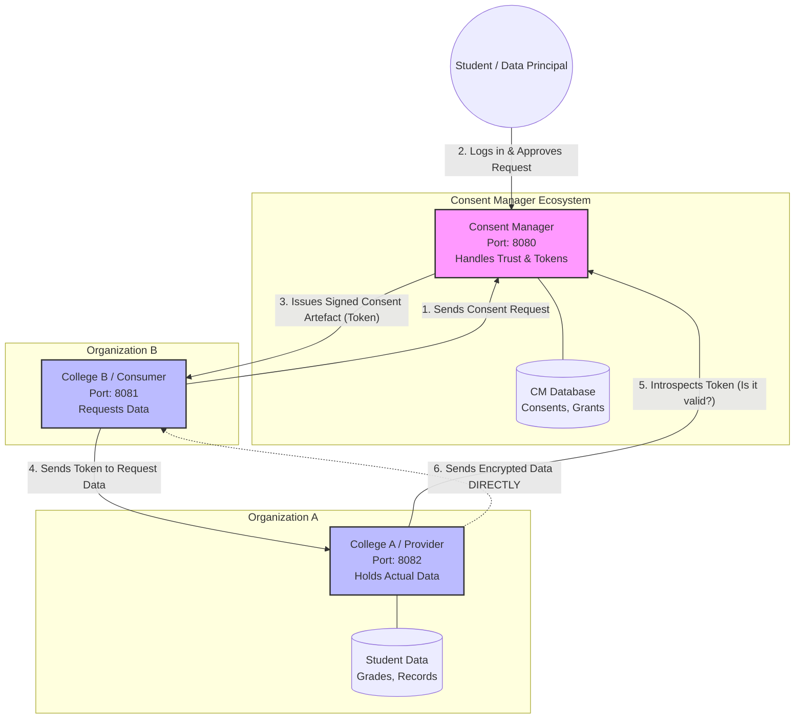
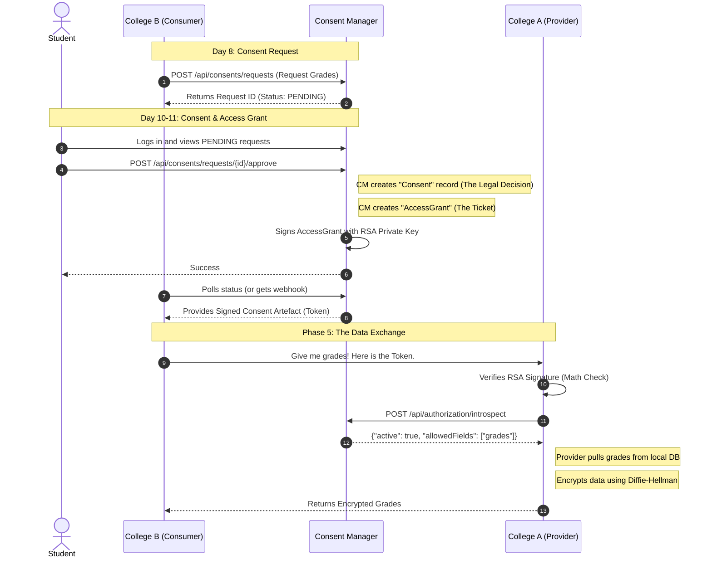

# Consent Manager Architecture & Workflow

Here are the diagrams explaining the system architecture and the step-by-step workflow of how data is securely requested, consented to, and transferred.

## 1. System Architecture

This diagram shows the three main Spring Boot applications and how they interact. Notice that **no actual student data (like grades or medical records)** ever passes through the Consent Manager. It only handles the cryptographic tokens (Consent Artefacts).

---

## 2. DEPA Consent Workflow (Sequence Diagram)

This diagram shows the strict step-by-step lifecycle we implemented in the code (Days 8-11). It shows the flow from `PENDING` to `ACTIVE` and finally to the secure data transfer.

